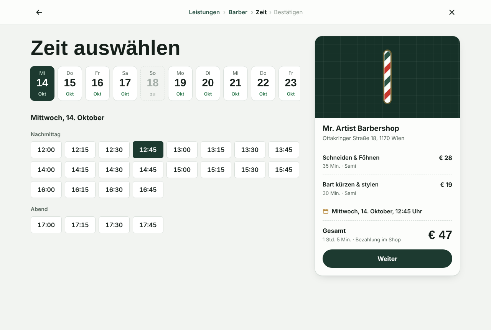
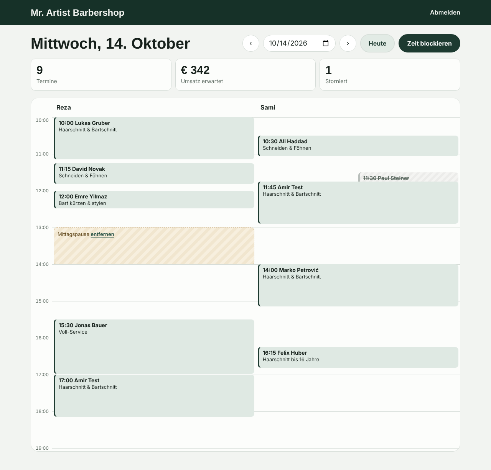

# BarberBook – Online-Terminbuchung für Barbershops

[](https://github.com/Amirsiasi/barbershop-booking/actions/workflows/ci.yml)

Ein eigenes Buchungssystem statt teurer Plattform-Gebühren. Erster Kunde: **Mr. Artist Barbershop**, Ottakringer Straße 18, 1170 Wien.

Entstanden aus meinem Projekt [customer-crud-spring-react](https://github.com/Amirsiasi/customer-crud-spring-react): Gleicher Stack (Spring Boot + React), gleiche Fehlerbehandlung, aber mit echter Fachlogik.


## Was es kann

**Für Kunden** (ohne Konto)
- In 4 Schritten buchen: Leistung → Barber (oder „egal“) → Tag und Uhrzeit → Name und Telefon
- Es werden nur wirklich freie Zeiten angezeigt (Öffnungszeiten, Dauer der Leistung, bestehende Termine, Pausen)
- Bestätigung mit Link zum Verwalten: Termin ansehen, in den Kalender speichern (.ics), bis 2 Stunden vorher selbst absagen
- Bestätigungs-E-Mail mit Kalender-Anhang (.ics) und Erinnerungs-E-Mail 24 Stunden vorher (weniger No-Shows)
- Funktioniert am Handy, Live-Status „Jetzt geöffnet bis 19:00 Uhr“

**Für den Shop** (`/admin`, mit Login)
- Tageskalender mit einer Spalte pro Barber
- Termine als „erschienen“, „nicht erschienen“ oder „storniert“ markieren, Telefonnummer direkt anrufen
- Zeit blockieren (Pause, Urlaub, Arzttermin) – in der Zeit kann niemand online buchen
- Kennzahlen des Tages: Termine, erwarteter Umsatz, Stornos




## Technik

| Teil | Technologie |
|---|---|
| Backend | Java 17, Spring Boot 3.3, Spring Data JPA, Spring Security, Bean Validation |
| Datenbank | PostgreSQL 16, Flyway-Migrationen |
| Frontend | React 18, Vite, React Router, eigenes CSS (keine UI-Bibliothek) |
| Betrieb | Docker Compose: Postgres + Backend + nginx (liefert Frontend aus und leitet `/api` weiter) |
| Tests | JUnit 5, AssertJ, MockMvc, Testcontainers |

### Die wichtigsten Entscheidungen

**Doppelbuchungen verhindert die Datenbank, nicht der Code.** In [`V1__schema.sql`](backend/src/main/resources/db/migration/V1__schema.sql) gibt es einen PostgreSQL *Exclusion Constraint*: Für denselben Barber dürfen sich zwei aktive Termine zeitlich nicht überschneiden. Auch wenn 20 Leute in derselben Millisekunde auf „Buchen“ drücken, bekommt genau einer den Termin – das prüft ein eigener Test. Bei „egal welcher Barber“ versucht das Backend dann automatisch den nächsten freien.

**Zeiten immer in UTC speichern.** Die Datenbank speichert `TIMESTAMPTZ`, die API liefert UTC. Umgerechnet auf `Europe/Vienna` wird nur bei der Berechnung der Slots und bei der Anzeige. Damit stimmt auch der Tag der Zeitumstellung.

**Slot-Berechnung ohne Datenbank testbar.** [`SlotCalculator`](backend/src/main/java/at/barberbook/booking/SlotCalculator.java) ist eine reine Funktion ohne Spring – daher einfache, schnelle Unit-Tests.

**Mehrere Shops von Anfang an.** Jede Tabelle hat eine `shop_id`. Mr. Artist ist Shop Nr. 1; ein zweiter Shop ist ein neuer Datensatz, kein neues Projekt.

**Benachrichtigungen austauschbar.** Hinter dem Interface `NotificationSender` stecken zwei Umsetzungen: `LoggingNotificationSender` (Standard, schreibt nur ins Log) und `EmailNotificationSender` (SMTP, wird automatisch aktiv, sobald `SPRING_MAIL_HOST` gesetzt ist). Die Bestätigung wird im Hintergrund verschickt (`@Async`), damit der Kunde nach dem Klick auf „Buchen“ nicht auf den Mailserver wartet. Ein Fehler beim Mailversand macht die Buchung nie ungültig. SMS wäre eine dritte Klasse – sonst ändert sich nichts.

## Starten

### Mit Docker (am einfachsten)

```bash
cp .env.example .env        # Passwörter darin ändern
docker compose up --build
```

- Buchungsseite: http://localhost:5173
- Admin: http://localhost:5173/admin (Zugangsdaten aus `.env`)

### Ohne Docker (zum Entwickeln)

PostgreSQL lokal anlegen:

```sql
CREATE ROLE barberbook LOGIN PASSWORD 'barberbook';
CREATE DATABASE barberbook OWNER barberbook;
```

Backend (Flyway legt Tabellen und Demo-Daten beim Start an):

```bash
cd backend
ADMIN_PASSWORD=geheim mvn spring-boot:run
```

Frontend (leitet `/api` an Port 8080 weiter):

```bash
cd frontend
npm install
npm run dev
```

### E-Mails verschicken

Ohne Einstellungen werden Bestätigungen und Erinnerungen nur ins Log geschrieben. Für echten Versand diese Umgebungsvariablen setzen (in IntelliJ unter *Environment variables*, bei Docker in `.env`):

| Variable | Brevo | Gmail (zum Testen) |
|---|---|---|
| `SPRING_MAIL_HOST` | `smtp-relay.brevo.com` | `smtp.gmail.com` |
| `SPRING_MAIL_PORT` | `587` | `587` |
| `SPRING_MAIL_USERNAME` | SMTP-Login aus Brevo → *SMTP & API* | deine Gmail-Adresse |
| `SPRING_MAIL_PASSWORD` | SMTP-Schlüssel aus Brevo | App-Passwort (braucht 2-Faktor-Anmeldung) |
| `MAIL_FROM` | bei Brevo bestätigte Absenderadresse | deine Gmail-Adresse |
| `MAIL_REPLY_TO` | optional, z. B. die Adresse des Shops | optional |

Im Log steht dann beim Start `E-mail sending enabled` und nach jeder Buchung `E-mail "…" sent to …`. Kunden ohne E-Mail-Adresse werden übersprungen.

Für den Livebetrieb: eine eigene Domain als Absender (z. B. `termine@mrartist.at`) mit SPF/DKIM-Einträgen beim Anbieter, sonst landen Mails oft im Spam.

### Tests

```bash
cd backend
mvn test
```

Die Integrationstests brauchen ein echtes PostgreSQL. Läuft Docker, startet Testcontainers es automatisch. Ohne Docker eine leere Test-Datenbank angeben:

```bash
TEST_DATABASE_URL=jdbc:postgresql://localhost:5432/barberbook_test mvn test
```

Ohne beides werden nur die Unit-Tests ausgeführt.

Bei jedem Push auf GitHub laufen über **GitHub Actions** ([`.github/workflows/ci.yml`](.github/workflows/ci.yml)) automatisch alle Backend-Tests inklusive der Integrationstests gegen PostgreSQL, der Frontend-Build und der Build beider Docker-Images.

## API

| Methode | Pfad | Zweck |
|---|---|---|
| GET | `/api/shops/{slug}` | Shop, Öffnungszeiten, Barber, Preisliste |
| GET | `/api/shops/{slug}/availability/days?serviceId&barberId&from&days` | Freie Termine pro Tag (Datumsleiste) |
| GET | `/api/shops/{slug}/availability?serviceId&barberId&date` | Freie Uhrzeiten an einem Tag |
| POST | `/api/shops/{slug}/appointments` | Termin buchen (409 wenn gerade vergeben) |
| GET | `/api/appointments/{token}` | Termin über den Link ansehen |
| POST | `/api/appointments/{token}/cancel` | Termin absagen (422 wenn zu spät) |
| GET | `/api/admin/day?date` | Tagesansicht (Login) |
| PATCH | `/api/admin/appointments/{id}` | Status ändern (Login) |
| POST / DELETE | `/api/admin/absences` | Zeit blockieren / freigeben (Login) |

Fehler kommen immer im gleichen Format (`ApiError` mit `validationErrors` pro Feld) – übernommen aus customer-crud-spring-react.

## Projektstruktur

```
backend/src/main/java/at/barberbook/
  shop/          Shop, Öffnungszeiten, Barber, Leistungen, Abwesenheiten
  booking/       Kunden, Termine, SlotCalculator, AvailabilityService, BookingService
  admin/         Login (Spring Security) und Admin-API
  notification/  Bestätigung und Erinnerung per E-Mail (ReminderJob alle 5 Minuten)
  common/        ApiError, GlobalExceptionHandler
backend/src/main/resources/db/migration/
  V1__schema.sql            Tabellen + Exclusion Constraint
  V2__seed_mr_artist.sql    Daten von Mr. Artist
frontend/src/
  pages/         Buchung, Termin verwalten, Admin
  components/    Hero, Ticket, Shop-Infos
  lib/           API-Client, Zeitzonen-Helfer, .ics-Export
```

## Vor dem Livegang

- [ ] Preise, Dauer der Leistungen, Telefonnummer und Arbeitszeiten der Barber mit dem Shop abstimmen (Daten stammen aus dem öffentlichen Treatwell-Profil, Stand Oktober 2026). Die Gesichtsbehandlung fehlt noch, weil die Dauer unbekannt ist.
- [ ] Impressum und Datenschutzerklärung schreiben (`/impressum`, `/datenschutz` sind Platzhalter)
- [ ] E-Mail-Anbieter mit eigener Absender-Domain einrichten (SPF/DKIM); SMS optional als weiterer `NotificationSender`
- [ ] Hosting in der EU (DSGVO), HTTPS, Backups der Datenbank
- [ ] Starkes Admin-Passwort; später eigene Logins pro Mitarbeiter

## Ideen für später

- Warteliste: frei werdende Termine automatisch anbieten
- Arbeitszeiten pro Barber statt nur Shop-Öffnungszeiten
- Anzahlung bei Neukunden über Stripe (gegen No-Shows)
- Google-Bewertung nach dem Termin anfragen
- Self-Service-Registrierung für weitere Shops (SaaS)
